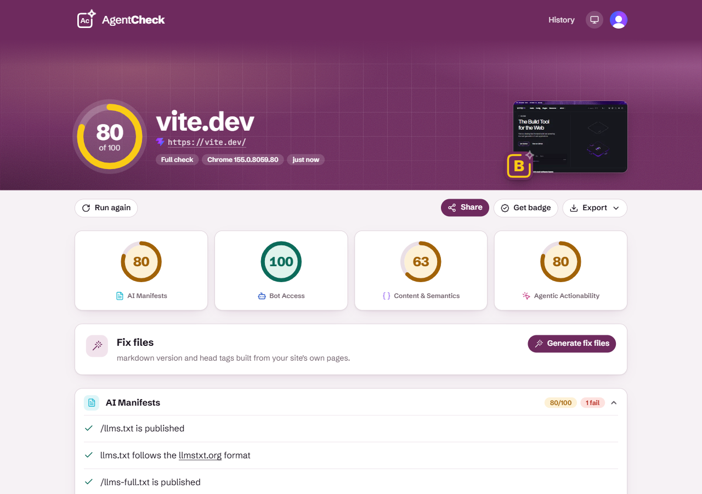

<div align="center">


# AgentCheck

**Is your website ready for AI agents?**

See how ChatGPT, Claude, Perplexity and browser agents read your site,
and get the files that fix what they trip over.

[**Check your site at agentcheck.dev**](https://agentcheck.dev) · [`npx agentcheck <url>`](#for-developers)

[](https://www.npmjs.com/package/agentcheck)
[](https://github.com/yanfishel/agentcheck/actions/workflows/ci.yml)

[](LICENSE)

<picture>
  <source media="(prefers-color-scheme: dark)" srcset="docs/assets/report-dark.png">
  
</picture>

</div>

## What it checks

| Category | What | Weight |
|---|---|---|
| AI manifests | `llms.txt`, `llms-full.txt`, markdown versions of your pages | 30% |
| Bot access | `robots.txt` rules for GPTBot, ClaudeBot, PerplexityBot, Google-Extended…; `noai` tags | 20% |
| Content & semantics | Real content versus menus, heading order, OpenGraph, JSON-LD | 25% |
| Agentic actionability | Buttons and fields with names, click traps, captchas, checked in a real browser | 25% |

Every check returns pass, warn or fail with a fix. The result is one score
from 0 to 100 and a grade from A+ to F.

## For site owners

Paste your URL at **[agentcheck.dev](https://agentcheck.dev)**. A quick check is
free and needs no account. Sign in for a full check in a real browser, a
history of your sites, share links, an *AI Ready* badge for your README, and
**fix files**: a ready `robots.txt`, `llms.txt`, a markdown version of the page
and the `<head>` tags, built from your own pages.

## For developers

<table>
<tr>
<td width="50%" valign="top">

**Audit from the terminal**

```sh
npx agentcheck https://your-site.com
```

```text
 [✓] Bot Access              100/100
 [!] AI Manifests             80/100
     ✗ /llms-full.txt not found (HTTP 404)
 ──────────────────────────────────────
 OVERALL AI SCORE: 94 / 100 [A]
```

</td>
<td width="50%" valign="top">

**Fail the build**

```sh
npx agentcheck "$URL" --threshold=85 --format=json
```

Exits non-zero below the threshold; stdout is the JSON
result only. `--format=html` writes a single-file report.
Browser checks use your installed Chrome, or
`npx playwright install chromium`; `--no-browser` skips them.

</td>
</tr>
</table>

### Let your coding agent fix it

```sh
npx agentcheck fix https://your-site.com
```

```text
agentcheck-fix/
  robots.txt  llms.txt  llms-full.txt  index.md  head.html
  README.md
  AGENT-PROMPT.md
```

Open the folder in Cursor, Claude Code or Copilot and hand it
`AGENT-PROMPT.md`: it tells the agent what each file is and where it goes in
your project. `--only=llms,llms-full` builds just those files and skips the
audit; nothing is overwritten without `--force`.

## How it works

Static checks fetch the page, `robots.txt` and `llms.txt` and read them with
cheerio. If a browser is available, headless Chromium renders the page to
check what an agent can click. Scoring is computed centrally from the raw
results. The CLI and the hosted service run the same engine; the service adds
a network guard against internal addresses, a job queue and a sandboxed
browser. Details: [docs/spec.md](docs/spec.md).

## Repository

| Path | What |
|---|---|
| `packages/core` | The audit engine, reporters and fix-file generator |
| `packages/db` | PostgreSQL schema, migrations and the job queue |
| `apps/cli` | The `agentcheck` CLI on npm |
| `apps/web` | The agentcheck.dev web app (Next.js) |
| `apps/worker` | The queue worker that runs audits for the service |
| `deploy` | Docker images and the Compose stack ([docs/deploy.md](docs/deploy.md)) |

## Contributing and security

Bug reports and ideas are welcome as
[issues](https://github.com/yanfishel/agentcheck/issues); pull requests are
accepted only from collaborators (see [CONTRIBUTING.md](CONTRIBUTING.md)).
Please report vulnerabilities privately as described in
[SECURITY.md](SECURITY.md), not in a public issue.

## License

[MIT](LICENSE) © Yan Fishel ([fishart](https://fishart.co.il))
